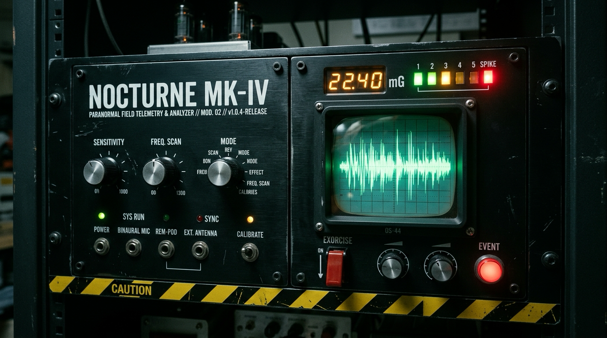

<div align="center">

# Project Nocturne (`MK-IV`)

**An ambient workstation poltergeist & retro-industrial paranormal telemetry console.**

[](https://github.com/boredpolymath/nocturne/releases/latest)
[](https://github.com/boredpolymath/nocturne/actions/workflows/release-security.yml)
[](LICENSE)
[](Cargo.toml)
[-0ea5e9?style=flat-square)](SECURITY.md)



[**Interactive Web Demo**](https://boredpolymath.github.io/nocturne/) · [**Download Binaries**](#-install--summon) · [**How It Works**](#-what-happens-in-the-silence) · [**Privacy Policy**](PRIVACY.md) · [**Build & Contribute**](#-contributing--hacking-on-nocturne)

</div>

---

## What is Nocturne?

**Nocturne** turns your computer into a subtly haunted late-night research station.

Designed with the tactile aesthetic of a 1970s rackmount **REM-Pod and CRT EVP Spectrograph**, Nocturne sits quietly in your system tray (`< 0.5%` CPU, `< 30 MB` RAM). During the witching hours (**00:00–05:00** by default, or any time you flip the **Curfew Override** switch), it watches for natural lulls in your typing and mouse movement.

When you pause to think and the room goes quiet, Nocturne answers:

- **Headphone-tracked binaural acoustics** — a floorboard creaks softly to your left, a buckling-spring key clicks once after you take your hands off the keyboard, or a faint 3-formant whisper sweeps across the stereo field. Every sound is synthesized mathematically in real time—**zero pre-recorded audio files**.
- **Subtle display & cursor anomalies** — your monitor's color temperature shifts imperceptibly over several seconds, or your mouse cursor drifts 2 pixels in a gentle figure-8 planchette curve.
- **Live CRT telemetry** — open the **Séance Panel** at any time to watch the 64-point phosphor-green oscilloscope, K-II EMF LED ladder, CPU thermal "cold-spot" gauges, and timestamped incident log react in real time.
- **Instant triple-`ESC` failsafe** — tap `ESC` `ESC` `ESC` at any time (or click the big red **Exorcise** button) to sever all audio, restore hardware monitor color profiles in under **50 milliseconds**, and lock the daemon into deep sleep.

---

## Install & Summon

Pre-built desktop deliverables and zero-dependency installers are published on [**GitHub Releases**](https://github.com/boredpolymath/nocturne/releases/latest) as well as direct zero-redirect downloads on the [**Official Website**](https://boredpolymath.github.io/nocturne/):

| Platform | Format / Architecture | Download Links |
| :--- | :--- | :--- |
| **macOS** | Apple Silicon (`M1`–`M4`) | [**Signed & Notarized DMG**](https://boredpolymath.github.io/nocturne/downloads/nocturne-macos-arm64.dmg) · [`.tar.gz`](https://boredpolymath.github.io/nocturne/downloads/nocturne-macos-arm64.tar.gz) |
| **macOS** | Intel (`x86_64`) | [**Signed & Notarized DMG**](https://boredpolymath.github.io/nocturne/downloads/nocturne-macos-x64.dmg) · [`.tar.gz`](https://boredpolymath.github.io/nocturne/downloads/nocturne-macos-x64.tar.gz) |
| **Windows** | Windows Installer (`MSI`) | [**Windows MSI Package**](https://boredpolymath.github.io/nocturne/downloads/nocturne-windows-x64.msi) |
| **Windows** | Standalone Setup (`NSIS .exe`) | [**NSIS Standalone Setup**](https://boredpolymath.github.io/nocturne/downloads/nocturne-windows-x64-setup.exe) · [`.zip`](https://boredpolymath.github.io/nocturne/downloads/nocturne-windows-x64.zip) |
| **Linux** | x64 (`Ubuntu/Debian/Fedora`) | [**Binary Deliverable (`.tar.gz`)**](https://boredpolymath.github.io/nocturne/downloads/nocturne-linux-x86_64.tar.gz) |

> **Want to experience it before installing?** Try the [**Interactive Browser Séance**](https://boredpolymath.github.io/nocturne/) (best with headphones).

### Your First 60 Seconds with Nocturne

1. **Launch the console**: Start `nocturne-daemon`. The **Séance Panel** opens alongside a persistent system tray icon.
2. **Test outside midnight hours**: By default, Nocturne only manifests between `00:00` and `05:00`. To experience it during the day, toggle **Curfew Time-Gate Override** in the console or click **`CAL: 50-60Hz`** to fire an immediate calibration manifestation.
3. **Customize your channels**: Enable or disable individual subsystems (**Acoustic Engine**, **Gamma LUT Shift**, or **Planchette Drift**), dial the **Intensity Detent** (`Subtle`, `Nominal`, `Aggressive`), or adjust the **Cognitive Lull Window** (`4.0s–15.0s` of inactivity before a manifestation triggers).
4. **Hit the panic switch**: Press `ESC` three times rapidly (`< 800ms`) or click **MANUAL EXORCISE PURGE CIRCUIT** to verify the hardware failsafe.

---

## What Happens in the Silence

### 1. Real-Time Procedural Acoustic Engine (`48 kHz` Stereo DSP)
Nocturne contains **zero `.wav` or `.mp3` files**. A lock-free stereo ringbuffer streams 32-bit float PCM directly to your audio device via `cpal`, synthesizing six distinct phenomena on the fly:

| Manifestation | What You Hear | How It's Synthesized |
| :--- | :--- | :--- |
| **Spatial Floorboard Creaks** | Aged timber flexing slowly to your left or right | Multi-modal stick-slip wood resonance with interaural time/level difference (ITD/ILD) panning and CPU temperature pitch coupling |
| **Phantom Keystroke Echoes** | A single ghost key press `2.5s` after you stop typing | `3.2 kHz` buckling-spring transient paired with a `420 Hz` damped keycap bottom-out |
| **Spirit-Box EVP Whispers** | Faint, unintelligible syllables sweeping past your ears | Band-limited aspiration noise sculpted through a 3-formant vocal tract (`F1`/`F2`/`F3`) with `5.5 Hz` syllabic modulation |
| **Wall-Stud Double-Knocks** | Two hollow raps inside the wall + a vintage relay click | `145 Hz` structural timber impulse (`165ms` interval) followed by a `2,400 Hz` reed-relay transient |
| **Redline 50/60 Hz Mains Hum** | Heavy transformer ground-loop hum & static crackle | `55/110/165 Hz` harmonic stack with `1,800 Hz` corona discharge, synced with CRT horizontal tear glitches |
| **Infrasonic Room Breath** | A subtle "fullness" in the air during high CPU load | `18–24 Hz` low-pass room standing-wave carrier modulated by live CPU junction temperature (`Tctl`) |

Every sample passes through a hard psychoacoustic limiter (`+6 dB` to `+18 dB` over a `-44.2 dBFS` ambient floor) so it never jump-scares or blasts your eardrums.

### 2. Spectral Color-Shifts & Planchette Drift
- **Hardware Monitor Gamma Perturbation**: Gently nudges native OS display color tables (`CoreGraphics` on macOS, `GDI` on Windows, `XF86VidMode` on Linux) along a smooth `>= 1,200ms` cubic-bezier curve, strictly clamped to **`<= 8.0%`** luminance delta.
- **Bimodal Spectral Phases**: Alternates between *Ectoplasmic Cyan-Violet Phase Inversion* and *Crimson Nightmare Solarization*.
- **Lissajous Planchette Micro-Drift**: Applies a subtle `1–3px` figure-8 nudge to the cursor at the onset of a lull—just enough to make you wonder if you bumped the desk.

### 3. The Séance Panel & System Tray
- **150ms CRT Sweep Loop**: Renders a live 64-point phosphor-green oscilloscope, a 5-stage **K-II EMF LED meter** (`1.5 mG` to `20+ mG SPIKE`), live CPU thermal & simulated `-4.1°C` cold-spot gauges, and a persistent SQLite incident log.
- **Headless Tray Operation**: Close or minimize the window (`Cmd+W` / `−`) to let Nocturne run silently in the menu bar or system tray, complete with quick snooze timers (`1h`, `4h`, `8h`).

---

## Privacy & Safety Guarantees

> For our complete, legally binding compliance disclosures, see our standalone [**Privacy Policy**](PRIVACY.md) or read it online at [**boredpolymath.github.io/nocturne/privacy.html**](https://boredpolymath.github.io/nocturne/privacy.html).

A daemon that watches for user inactivity and touches hardware display tables must be uncompromisingly trustworthy:

- **Zero Keylogging**: Nocturne **never** reads what you type. It queries only the OS-level idle timer ("seconds since last input event" via `CGEventSourceSecondsSinceLastEventType` / `GetLastInputInfo` / `XScreenSaverQueryInfo`). Even the triple-`ESC` failsafe filters exclusively for keycode `0x1B` in a 3-slot timestamp ringbuffer and drops all other input unread.
- **100% Air-Gapped (Zero Network Egress)**: Nocturne has no telemetry servers, no analytics, no auto-updater, and no network crates (`reqwest`, `hyper`, `curl`, `openssl`, and `rustls` are explicitly banned in [`deny.toml`](deny.toml)). At startup, `AirGapEnforcer` inspects open POSIX file descriptors to ensure zero `AF_INET`/`AF_INET6` sockets exist, backed by a strict `connect-src 'none'` CSP and macOS Seatbelt sandbox ([`nocturne-airgap.sb`](src-tauri/nocturne-airgap.sb)).
- **Guaranteed Hardware Restoration**: `std::panic::set_hook` and POSIX signal handlers (`SIGINT`, `SIGTERM`, `SIGHUP`) ensure that even if the process is killed or crashes, your monitor's original hardware gamma table is immediately restored.

---

## Contributing & Hacking on Nocturne

We love contributors—whether you're into **real-time audio DSP**, **low-level OS systems programming in Rust**, **retro CRT hardware interfaces**, or **paranormal lore**.

### Why Hack on This Repo?
- **Pure Rust DSP Playground**: Write mathematical sound synthesizers in [`src-tauri/src/audio/mod.rs`](src-tauri/src/audio/mod.rs) and see them immediately on a live 64-point CRT oscilloscope.
- **Zero-Framework Frontend**: The Séance Panel ([`src/`](src/)) is built with clean, dependency-free HTML5, CSS3, and Canvas—no webpack, no Virtual DOM bloat, instant reload.
- **Clean, Well-Tested Codebase**: 54 fast unit and integration tests covering audio synthesis, gamma curve clamping, SQLite WAL retention, panic failsafes, and air-gap verification.

### Ideas for Your First Pull Request
- **New Acoustic Manifestations**: Synthesize Geiger counter ticks, grandfather clock pendulum stops, distant Morse code carriers, or vinyl run-out groove crackle.
- **New CRT Visualizer Modes**: Add an X-Y Lissajous vector scope mode or waterfall spectrogram toggle to the Séance Panel canvas.
- **Platform & Display Enhancements**: Native Wayland gamma control (`wlr-gamma-control-unstable-v1`) or multi-monitor staggered wave propagation.
- **Custom Vigil Profiles**: Import/export haunting presets or lunar-phase manifestation multipliers.

Check out [**CONTRIBUTING.md**](CONTRIBUTING.md) for architecture details, safety invariants, and step-by-step instructions.

---

## Build from Source

### Prerequisites
- **Rust** `1.77.2+` (`rustup` will automatically select the pinned toolchain via [`rust-toolchain.toml`](rust-toolchain.toml))
- **Node.js** `18+` (used only for the `@tauri-apps/cli` runner)
- **Linux only**: System headers for WebKitGTK and ALSA:
  ```bash
  sudo apt-get install -y build-essential pkg-config libssl-dev libwebkit2gtk-4.1-dev \
    libayatana-appindicator3-dev librsvg2-dev patchelf libasound2-dev libxss-dev libxrandr-dev
  ```

### Quickstart Commands

```bash
# 1. Clone the repository
git clone https://github.com/boredpolymath/nocturne.git
cd nocturne

# 2. Install the Tauri CLI wrapper
npm install

# 3. Run the 54-test suite across all subsystems
cargo test --workspace

# 4. Launch Nocturne in development mode with hot-reload
npm run dev

# 5. Build a production desktop bundle for your OS
npm run build
```

### Verification & Supply-Chain Checks

```bash
# Run Clippy with warnings-as-errors and verify Rustfmt formatting
npm run lint:rust
npm run fmt:rust

# Verify deterministic CycloneDX 1.5 SBOM & SHA-256 source checksums
python3 scripts/generate_release_integrity.py --verify
```

---

## Repository Map

```text
nocturne/
├── src/                            # Séance Panel Frontend (HTML5 / CSS3 / Canvas CRT)
│   ├── index.html                  # Rackmount console layout & K-II EMF meters
│   ├── styles/main.css             # Phosphor-green CRT & industrial hardware styling
│   └── js/app.js                   # 64-pt oscilloscope renderer & Tauri v2 IPC bridge
├── src-tauri/                      # Rust Core Daemon & Telemetry Engine
│   ├── src/audio/mod.rs            # 48 kHz lock-free PCM ringbuffer & 6-mode DSP synth
│   ├── src/display/mod.rs          # Native OS gamma LUT curves & planchette cursor drift
│   ├── src/telemetry/              # OS idle hooks, vigil chronometer & resource profiler
│   ├── src/panic/mod.rs            # Triple-ESC (<800ms) hardware exorcise failsafe
│   ├── src/db/mod.rs               # Embedded SQLite (WAL) config & 10k-row incident log
│   ├── src/security/mod.rs         # Zero-egress POSIX socket scrubber & air-gap auditor
│   ├── src/tray/mod.rs             # System tray lifecycle & snooze timer controller
│   └── src/ipc/mod.rs              # 14 strongly typed Tauri v2 command handlers
├── assets/                         # Visual brand assets & 1080x1080 1:1 store box art
├── website/                        # Interactive GitHub Pages demo & direct zero-redirect download host
├── scripts/                        # Reproducible CycloneDX SBOM & SHA-256 generator
└── deny.toml                       # Cargo-deny air-gap crate bans & license policy
```

---

## Community & Governance

- [**Contributing Guide**](CONTRIBUTING.md) — How to set up your environment, add new manifestations, and submit PRs.
- [**Code of Conduct**](CODE_OF_CONDUCT.md) — Our commitment to a welcoming, harassment-free community.
- [**Security Policy**](SECURITY.md) — Air-gap architecture, supply-chain verification, and how to report vulnerabilities.
- [**License**](LICENSE) — Dual-licensed under **MIT** or **Apache-2.0** at your option.
